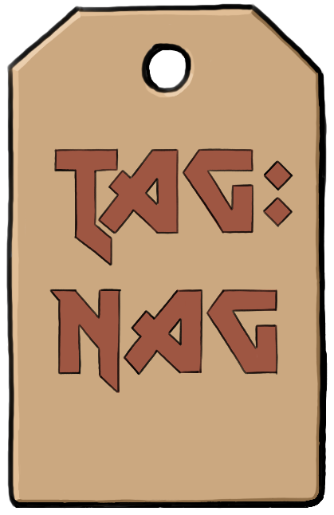
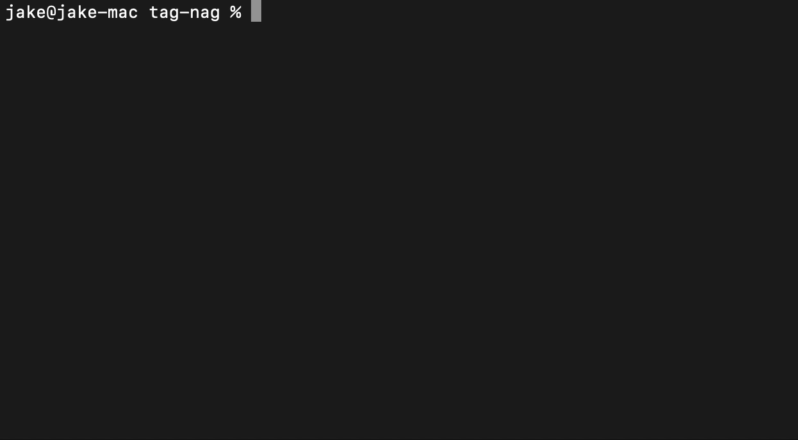

<div align="center">

## 

[](./go.mod)
[](https://goreportcard.com/report/github.com/jakebark/tag-nag)
[](https://pkg.go.dev/github.com/jakebark/tag-nag)
[](https://hub.docker.com/r/jakebark/tag-nag)

Validate AWS tags in Terraform and CloudFormation.  



</div>

## Installation
```bash
go install github.com/jakebark/tag-nag@latest
```
You may need to set [GOPATH](https://go.dev/wiki/SettingGOPATH).

## Commands

Tag-nag will search a file or directory for tag keys. Directory search is recursive.

```bash
tag-nag <file/directory> --tags "Key1,Key2"

tag-nag main.tf --tags "Owner" # run against a file
tag-nag ./my_project --tags "Owner,Environment" # run against a directory
tag-nag . --tags "Owner", "Environment" # will take string or list

```

Search for tag keys *and* tag values

```bash
tag-nag <file/directory> --tags "Key[Value]"

tag-nag main.tf --tags "Owner[Jake]" 
tag-nag main.tf --tags "Owner[Jake],Environment" # mixed search possible
tag-nag main.tf --tags "Owner[Jake],Environment[Dev,Prod]" # multiple options for tag values

```

Flags
```bash
-c --case-insensitive  
-d --dry-run # will always exit successfully
--cfn-spec ~/path/to/CloudFormationResourceSpecification.json # path to Cfn spec file, filters taggable resources
-s --skip "file.tf, path/to/directory" # skip files and directories
-o --output json # output to json (default is text)
--output-file results.json # write output to a file instead of stdout
-w --warning # exit code 2 instead of 1 for CI warning support
```

## Config file

The above commands can be issued with a `.tag-nag.yml` file in the same directory where tag-nag is run. 

See the [example .tag-nag.yml file](./examples/.tag-nag.yml).  

## Skip Checks

Skip file
```hcl
#tag-nag ignore-all
```

Terraform
```hcl
resource "aws_s3_bucket" "this" {
  #tag-nag ignore
  bucket   = "that"
}
```

CloudFormation
```yaml
EC2Instance:  #tag-nag ignore
    Type: "AWS::EC2::Instance"
    Properties: 
      ImageId: ami-12a34b
      InstanceType: c1.xlarge   
```

## Filtering taggable resources

Some AWS resources cannot be tagged. 

To filter out these resources with Terraform, run tag-nag against an initialised directory (`terraform init`). If using docker, add terraform to the tag-nag image. 

To filter out these resources with CloudFormation, specify a path to the [CloudFormation JSON spec file](https://docs.aws.amazon.com/AWSCloudFormation/latest/UserGuide/cfn-resource-specification.html) with the `--cfn-spec` input. 

## Docker
Run
```bash
docker pull jakebark/tag-nag:latest
docker run --rm -v $(pwd):/workspace -w /workspace jakebark/tag-nag \
  . --tags "Owner,Environment" 

```

Interactive shell
```bash
docker pull jakebark/tag-nag:latest
docker run -it --rm \
  -v "$(pwd)":/workspace \
  -w /workspace \
  --entrypoint /bin/sh jakebark/tag-nag:latest
```
## CI/CD

Example CI files:
- [GitHub](./examples/github.yml)
- [GitLab](./examples/gitlab.yml)
- [AWS CodeBuild](./examples/codebuild.yml)

## Related Resources

- [pkg.go.dev/github.com/jakebark/tag-nag](https://pkg.go.dev/github.com/jakebark/tag-nag)
